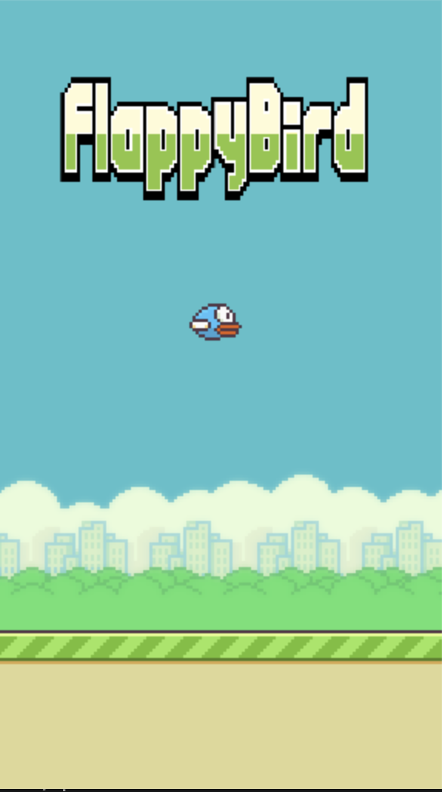

# Flappy Bird Clone

A classic Flappy Bird mini-game built with Python and Pygame, featuring retro visuals, smooth physics, score tracking, and authentic 8-bit sound effects.

<p align="center">
  
</p>

---

## Features

- **Classic Gameplay**: Dodge moving pipes and navigate your bird as far as you can.
- **Physics & Animations**: Gravity simulation, tilting angles, and wing flapping animations.
- **Randomized Elements**: Dynamic day/night backgrounds, pipe colors, and bird skins on each run.
- **Retro Audio**: Integrated sound effects for flapping, scoring, collisions, and game over.
- **Score Tracking**: Visual retro score display updated as you clear pipes.

---

## Prerequisites

Make sure you have **Python 3.8+** installed on your system.

Install the required library (`pygame`):

```bash
pip install pygame
```

---

## How to Run

1. Open your terminal and navigate to the project directory:
   ```bash
   cd "Flappy Bird"
   ```

2. Launch the game:
   ```bash
   python3 main.py
   ```

---

## Controls

| Action | Control |
| :--- | :--- |
| **Start / Jump (Flap)** | **Left Mouse Click** |
| **Restart Game** | **Left Mouse Click** (after Game Over) |
| **Quit Game** | **`ESC`** or **`Q`** |

---

## Project Structure

```text
├── Assets/        # Graphic sprites (bird colors, backgrounds, pipes, digits)
├── Sounds/        # Audio files (.wav) for wings, hit, point, and die sounds
├── game.png       # Preview screenshot
├── objects.py     # Classes for Grumpy (bird), Pipe, Base, and Score
├── main.py        # Main game loop, window setup, and event handling
└── README.md      # Project documentation
```

---

## License

This project is created for educational and entertainment purposes.
